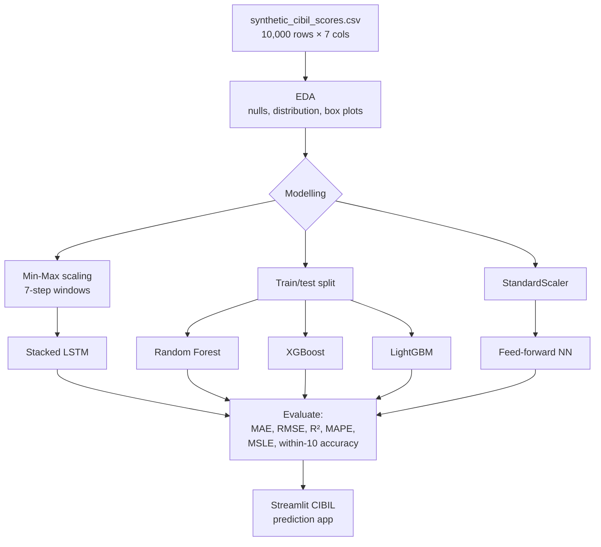

# Optimization of Dynamic Credit Scoring Models for Financial Risk Assessment


An AI-driven model that predicts **CIBIL scores** dynamically from an applicant's financial behaviour. It compares a deep learning approach (LSTM, feed-forward neural network) with tree-based ensembles (Random Forest, XGBoost, LightGBM).

> B.Tech final-year project, Computer Science and Engineering (AIML), batch 2021–2025, academic year 2024–2025.

---

## Problem Statement

Traditional credit scoring models rely on a static calculation of an individual's creditworthiness and ignore real-time financial behaviour and transactions, so credit risk can be judged wrongly or on outdated information. This project proposes a dynamic credit scoring model, built on machine learning, that updates an account's score as financial activity continues. It draws on payment history, credit utilisation, loan repayments and other behavioural indicators.

## Dataset

`synthetic_cibil_scores.csv` holds **10,000 synthetic records** with no missing values and seven columns:

| Column | Description |
|---|---|
| `Payment_History` | Payment history score |
| `Credit_Utilization` | Credit utilisation ratio (0–1) |
| `Credit_Age` | Age of credit history |
| `Number_of_Accounts` | Number of credit accounts |
| `Hard_Inquiries` | Number of hard credit inquiries |
| `Debt_to_Income_Ratio` | Debt-to-income ratio (0–1) |
| `CIBIL_Score` | Target: CIBIL score |

> The CSV is **not included in this repository**. The notebook loads it from `/content/synthetic_cibil_scores.csv` (Google Colab). A synthetic dataset with the same schema ships with [Credit-Risk-Analyzer](https://github.com/Gonugunta-Venkata-Jayanth/Credit-Risk-Analyzer).

## Approach

1. **EDA:** `info()`, transpose view, null check, target value distribution, and box plots of each feature against the CIBIL score.
2. **LSTM (time-series framing):**
   - Min-Max scaling of all columns.
   - Sliding windows of 7 time steps (`create_dataset`).
   - Two stacked `LSTM(50)` layers → `Dense(25)` → `Dense(n_features)`. Adam optimiser, MSE loss, custom RMSE, R² and "within-10-points" accuracy metrics, 50 epochs, 20% validation split.
   - Saved as `cibil_score.h5` and reloaded for evaluation.
3. **Random Forest Regressor:** 300 estimators, 67/33 train/test split.
4. **Gradient boosting:** XGBoost (`n_estimators=100, learning_rate=0.1, max_depth=5`) and LightGBM (same settings), 70/30 split.
5. **Feed-forward neural network:** Dense 64 → 32 → 16 → 1 (ReLU) on standardised features, 100 epochs.
6. **Evaluation metrics:** MAE, MSE, RMSE, MAPE, R², MSLE, explained variance, and custom accuracy (prediction within ±10 points).

## Workflow



## Tech Stack

- **Language:** Python 3.10 (Google Colab)
- **Deep learning:** TensorFlow / Keras (LSTM, Dense)
- **Machine learning:** scikit-learn (Random Forest, scaling, metrics), XGBoost, LightGBM
- **Data and visualisation:** pandas, NumPy, Matplotlib, Seaborn
- **App (described in the poster):** Streamlit

## Project Structure

```
-Optimization-of-Dynamic-Credit-Scoring-Model-For-Financial-Risk-Assessment/
├── CIBIL SCORE Various Algorithms.ipynb                    # EDA + LSTM, RF, XGBoost, LightGBM, FFNN
├── OPTIMIZATION OF DYNAMIC CREDIT SCORING Poster design.pdf # Project poster
└── README.md
```

## How to Run

1. Open `CIBIL SCORE Various Algorithms.ipynb` in [Google Colab](https://colab.research.google.com/) or Jupyter.
2. Upload `synthetic_cibil_scores.csv` to `/content/`, or change the path in the second cell.
3. Install the dependencies if you are running locally:
   ```bash
   pip install numpy pandas seaborn matplotlib scikit-learn tensorflow xgboost lightgbm
   ```
4. Run the cells in order. The Google Drive mount cell is optional.

## Results

The figures below are the outputs recorded in the notebook.

**LSTM:** evaluated on the windowed sequences built from the full scaled dataset

| Metric | Value |
|---|---|
| MAE | 6.24 |
| RMSE | 12.07 |
| R² | 0.0047 |
| Within ±10 points | 82.87% |

**Random Forest Regressor:** 33% hold-out test set

| Metric | Value |
|---|---|
| MSE | 0.22 |
| MAE | 0.138 |
| RMSE | 0.467 |
| R² | 1.00 |
| Explained variance | 0.9979 |

**XGBoost:** 30% hold-out test set: MSE 0.19, R² 1.00.
**LightGBM:** 30% hold-out test set: MSE 0.21, R² 1.00.

On this synthetic dataset, the tree-based ensembles fit the target far more closely than the LSTM. The poster's conclusion highlights Random Forest as the core model of the dynamic scoring system.

## Poster

See [`OPTIMIZATION OF DYNAMIC CREDIT SCORING Poster design.pdf`](OPTIMIZATION%20OF%20DYNAMIC%20CREDIT%20SCORING%20Poster%20design.pdf) for the abstract, methodology, results (Streamlit prediction app), conclusion, future work and references.

## Team & Guidance

- **Team:** GV Jayanth, K Chandu Goud, B Sreeja
- **Guides:** Prof. Rambabu Mudusu (HoD & Associate Professor), Dr. K. Maithili (Associate Professor)

## Author

**Jayanth Gonugunta Venkata** · [GitHub](https://github.com/Gonugunta-Venkata-Jayanth)
