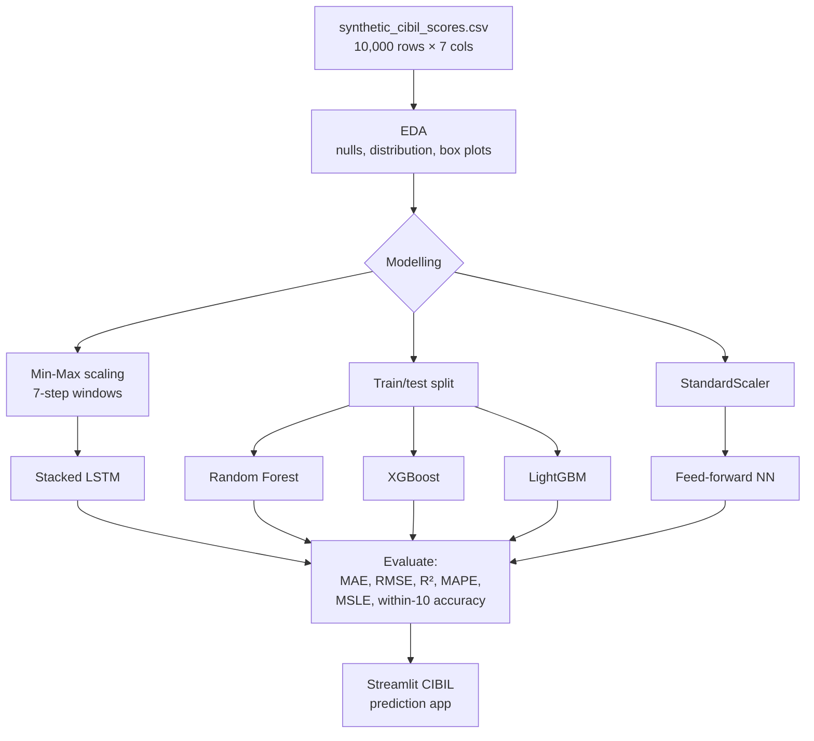

# Optimization of Dynamic Credit Scoring Models for Financial Risk Assessment


An AI-driven model that predicts **CIBIL scores** dynamically from an applicant's financial behaviour. It compares a deep learning approach (LSTM, feed-forward neural network) with tree-based ensembles (Random Forest, XGBoost, LightGBM).

> B.Tech final-year project, Computer Science and Engineering (AIML), batch 2021–2025, academic year 2024–2025.

---

## Problem Statement

Traditional credit scoring models rely on a static calculation of an individual's creditworthiness and ignore real-time financial behaviour and transactions, so credit risk can be judged wrongly or on outdated information. This project proposes a dynamic credit scoring model, built on machine learning, that updates an account's score as financial activity continues. It draws on payment history, credit utilisation, loan repayments and other behavioural indicators.

## Dataset

`synthetic_cibil_scores.csv` holds **10,000 synthetic records** with no missing values and seven columns:

| Column | Description |
|---|---|
| `Payment_History` | Payment history score |
| `Credit_Utilization` | Credit utilisation ratio (0–1) |
| `Credit_Age` | Age of credit history |
| `Number_of_Accounts` | Number of credit accounts |
| `Hard_Inquiries` | Number of hard credit inquiries |
| `Debt_to_Income_Ratio` | Debt-to-income ratio (0–1) |
| `CIBIL_Score` | Target: CIBIL score |

> The CSV is **not included in this repository**. The notebook reads `synthetic_cibil_scores.csv` from its own folder (on Colab, upload it to `/content/`). [Credit-Risk-Analyzer](https://github.com/Gonugunta-Venkata-Jayanth/Credit-Risk-Analyzer) ships a file with the same name and columns, but its `CIBIL_Score` values are different (spread across 300–900), so results from it will not match this project's data.

**Class imbalance:** in the dataset used here, **83.14% of rows have `CIBIL_Score` exactly 300.00** (the floor), and the remaining 1,300 distinct values are mostly just above 300 (see the `value_counts` cell). A model that always predicts about 300 already lands within ±10 points for most rows, so the "within ±10 points" accuracy and the near-perfect tree-model scores mostly reflect this skew rather than real predictive power. Rebalancing, or a dataset with a realistic score spread, is needed before drawing conclusions.

## Approach

1. **EDA:** `info()`, transpose view, null check, target value distribution, and box plots of each feature against the CIBIL score.
2. **LSTM (time-series framing):**
   - Min-Max scaling of all columns.
   - Sliding windows of 7 time steps (`create_dataset`).
   - Chronological split: first 80% of sequences for training, last 20% held out for testing.
   - Two stacked `LSTM(50)` layers → `Dense(25)` → `Dense(n_features)`. Adam optimiser, MSE loss, MAE, RMSE and R² metrics, 50 epochs, 20% validation split of the training sequences.
   - Saved as `cibil_score.h5`, reloaded, and evaluated on the held-out sequences for the `CIBIL_Score` column in original units.
3. **Random Forest Regressor:** 300 estimators, 67/33 train/test split.
4. **Gradient boosting:** XGBoost (`n_estimators=100, learning_rate=0.1, max_depth=5`) and LightGBM (same settings), 70/30 split.
5. **Feed-forward neural network:** Dense 64 → 32 → 16 → 1 (ReLU) on standardised features, 100 epochs.
6. **Evaluation metrics:** one shared `print_metrics` helper reports MAE, MSE, RMSE, MAPE, R², MSLE, explained variance, and custom accuracy (prediction within ±10 points) from each model's own test-set predictions.

## Workflow



## Tech Stack

- **Language:** Python 3.10 (Google Colab)
- **Deep learning:** TensorFlow / Keras (LSTM, Dense)
- **Machine learning:** scikit-learn (Random Forest, scaling, metrics), XGBoost, LightGBM
- **Data and visualisation:** pandas, NumPy, Matplotlib, Seaborn
- **App (described in the poster):** Streamlit

## Project Structure

```
-Optimization-of-Dynamic-Credit-Scoring-Model-For-Financial-Risk-Assessment/
├── CIBIL SCORE Various Algorithms.ipynb                    # EDA + LSTM, RF, XGBoost, LightGBM, FFNN
├── OPTIMIZATION OF DYNAMIC CREDIT SCORING Poster design.pdf # Project poster
├── requirements.txt
└── README.md
```

## How to Run

1. Open `CIBIL SCORE Various Algorithms.ipynb` in [Google Colab](https://colab.research.google.com/) or Jupyter.
2. Put `synthetic_cibil_scores.csv` next to the notebook (on Colab, upload it to `/content/`).
3. Install the dependencies if you are running locally:
   ```bash
   pip install -r requirements.txt
   ```
4. Run the cells in order. The Google Drive mount cell is skipped automatically outside Colab.

## Results

The evaluation code was corrected: earlier versions printed the Random Forest's MAE/RMSE and the LSTM's accuracy under the XGBoost and LightGBM headings, scored the feed-forward network with LightGBM's predictions, and evaluated the LSTM on the same data it was trained on. The numbers previously quoted here came from those cells, so they have been removed.

The dataset is not in this repository, so the notebook has not been re-run with the corrected code. Run it with the original `synthetic_cibil_scores.csv` to get valid figures, and read them alongside the class-imbalance note above.

## Poster

See [`OPTIMIZATION OF DYNAMIC CREDIT SCORING Poster design.pdf`](OPTIMIZATION%20OF%20DYNAMIC%20CREDIT%20SCORING%20Poster%20design.pdf) for the abstract, methodology, results (Streamlit prediction app), conclusion, future work and references.

## Team & Guidance

- **Team:** GV Jayanth, K Chandu Goud, B Sreeja
- **Guides:** Prof. Rambabu Mudusu (HoD & Associate Professor), Dr. K. Maithili (Associate Professor)

## Author

**Jayanth Gonugunta Venkata** · [GitHub](https://github.com/Gonugunta-Venkata-Jayanth)
